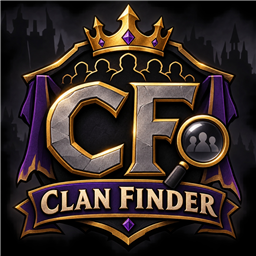

<div align="center">
  

  # OSRS Clan Finder
  **A Premier Clan Directory, EHB/EHP Leaderboard & Player Eligibility Checker for RuneLite**

  [](https://runelite.net/plugin-hub)
  [](LICENSE)
  [](https://discord.gg/99qEk9cWFW)
</div>

---

## Overview

**OSRS Clan Finder** is a comprehensive sidebar module for **RuneLite** designed to help Old School RuneScape players discover, compare, and join verified clans across the community. 

Built with a modern, dark-themed dashboard interface tailored specifically for the RuneLite side panel, the plugin provides verified recruitment requirements, real-time statistics synchronised with **TempleOSRS**, **Wise Old Man**, and **OSRSClans**, independent **EHB & EHP Rankings**, and an interactive **Player Eligibility Checker** (`Check My Eligibility`).

---

## Want to Add Your Clan or Have Questions?

Are you a clan leader or administrator looking to have your clan listed or updated in **OSRS Clan Finder**, or do you have any questions, feedback, or support enquiries?

👉 **[Join our Official Support & Clan Submission Discord Server: https://discord.gg/99qEk9cWFW](https://discord.gg/99qEk9cWFW)**

When submitting a clan on our Discord server, please share:
1. **Clan Name**, **In-Game Clan Chat**, and **Home World**.
2. **Account Type Classification** (`Ironman Only`, `Main Accounts Only`, or `Mixed (Ironman and Main Accounts)`).
3. **Primary Category** (`PvM`, `Ironman`, `Social`, or `Mixed / Community`).
4. **Official Links** (Official Website, Recruitment Page, Discord Invite, **Wise Old Man** group link, and/or **TempleOSRS** group link).
5. **Published Recruitment Requirements** with traceable source links.

---

## Core Features

### 1. Visual Clan Cards & Custom Identities
Every clan entry features an individual visual card inside the RuneLite sidebar:
- **Official Banners & Logos**: Automatically loads official clan banners and logos (with in-memory caching) or generates a bespoke, high-contrast heraldic crest and banner unique to each clan's colour palette.
- **2×2 Statistics Dashboard**: Displays **Members Count**, **Total XP**, **Average EHP**, and **Average EHB** at a glance.
- **Account Type & Recruitment Badges**: Clearly indicates whether recruitment is open and whether the clan accepts `Ironman Only`, `Main Accounts Only`, or `Mixed (Ironman and Main Accounts)`.
- **One-Click Official Links**: Direct buttons to open the clan's **Official Website**, **Discord Server**, **TempleOSRS Group**, and **Wise Old Man Profile**.

### 2. Organised Clan Categories
Browse and filter clans across four dedicated categories:
- **PvM**: High-level and endgame bossing and raiding clans (including *Oblivion*, *Vintage*, *Sanity*, *Infernal*, *Forbidden*, *Menace*, *Candor*, *Slaystars*, *Aus Myth*, *Pink LSZ*, *Prodigy*, *Reborn OSRS*, *Simply Better PvM*, *Live ON*, and *Mirage*).
- **Ironman**: Clans dedicated exclusively to Ironman account modes (including *Valiance*, *Olympus*, *07 Iron*, *Iron Clan*, *Fe Prestige*, *Irons Tavern*, *Iron Relax*, *Defiant*, *Ironic*, *Merit*, *Irons Grotto*, *WeNeverTrade*, and *Iron Foundry*).
- **Social**: Welcoming social and community-focused clans (including *Home*, *FOH*, *Scuff Unit*, *BigDog*, *Swedes*, *Ocage*, *Skadoosh*, *Valkyrie*, *Winter*, *Avandra*, *Elysium*, *Veritas*, *Smoke Scape*, *Grind It*, and *Live ON*).
- **Mixed / Community**: Well-rounded clans offering a simultaneous blend of PvM, skilling competitions (SOTW/BOTW), clan bingos, raids, and social events.

### 3. Independent EHB & EHP Rankings
Switch to the **EHB / EHP Rankings** tab to compare clans across six distinct leaderboards (strictly separating per-member averages from cumulative clan totals):
- **Average EHB** (Efficient Hours Bossed per member)
- **Average EHP** (Efficient Hours Played per member)
- **Total EHB** (Cumulative clan EHB)
- **Total EHP** (Cumulative clan EHP)
- **Members Count** (Tracked roster size)
- **Total XP** (Cumulative clan experience)

Each leaderboard entry displays the clan's rank position (`#1`, `#2`, `#3`...), rank movement indicator, number of members considered, and the last verification date.

### 4. Interactive Player Eligibility Checker (`Check My Eligibility`)
Click **Check My Eligibility** on any clan card or profile page to compare your own OSRS account statistics against the clan's actual published requirements:
- **Live In-Game Detection**: Automatically reads your logged-in OSRS combat level, total level, individual skill levels, total experience, Quest Points, and account type (Main vs Ironman).
- **Hiscores & Wise Old Man RSN Lookup**: Look up any RuneScape Name (RSN) to verify combined Raid completions (Chambers of Xeric, Theatre of Blood, Tombs of Amascut), Boss kill counts, and EHB.
- **Detailed Requirement Breakdown**: Shows the exact required value, your current value, remaining progress, and a clear status badge (`Requirement Met`, `Requirement Not Met`, `Not Applicable`, or `Unable to Verify`).

### 5. Live Synchronisation & Data Integrity
- **Automated Tracker Sync**: Periodically synchronises member counts, EHP, EHB, and Total XP from **TempleOSRS**, **Wise Old Man**, and **OSRSClans**.
- **Strict Verification Standards**: Requirements are never fabricated or guessed. Every requirement includes a traceable source URL, a verification status badge (`Officially Verified`, `Community Confirmed`, `Unverified`, or `Outdated`), and a verification date. When a clan does not publish fixed public thresholds, the plugin explicitly states:
  > *"Unconfirmed requirements — check official Discord."*

---

## How to Use

1. Open **RuneLite** and click the **OSRS Clan Finder** crest icon (`CF`) in the right-hand navigation toolbar.
2. **Browse the Directory**:
   - Filter by category (**All Clans**, **PvM**, **Ironman**, **Social**, **Mixed / Community**).
   - Search by clan name, region, or in-game Clan Chat.
   - Sort clans by **Average EHB**, **Average EHP**, **Members Count**, or **Alphabetical (A – Z)**.
3. **Inspect Clan Details**:
   - Click **Open Clan Profile & Full Stats** (or click the clan's banner) to view its full description, activities, historical statistics, verified requirements, and official external links.
4. **Check Your Eligibility**:
   - Click **Check My Eligibility** while logged into OSRS (or enter your RSN and click **Lookup RSN on Hiscores / Wise Old Man**) to see a requirement-by-requirement breakdown of your progress.
5. **View Rankings**:
   - Click **EHB / EHP Rankings** at the top of the panel to switch between the **Ranking EHB (Avg)** and **Ranking EHP (Avg)** leaderboards.

---

## Configuration Options

In the RuneLite plugin settings for **OSRS Clan Finder**, you can customise:
- **Fallback RSN for Eligibility Check**: Default RuneScape Name to look up when checking eligibility whilst logged out.
- **Account Type Override**: Optional manual account type selection (`Ironman Only`, `Main Accounts Only`, `Mixed`, `Unconfirmed`).
- **Fetch Hiscores for Raid & Boss KC**: Toggle querying Wise Old Man / official Hiscores for Raid and Boss kill counts.
- **Remote Verified Clan JSON URL**: Optional endpoint allowing administrators to push verified clan requirement updates without requiring a new plugin release.
- **Periodic Wise Old Man Verification**: Toggle and configure the interval (in minutes) for background metadata synchronisation.

---

## Building From Source

```bash
# Run verification & data integrity unit tests
./gradlew test

# Build the plugin JAR
./gradlew build

# Launch RuneLite in developer mode with OSRS Clan Finder loaded
./gradlew run
```

---

## Support, Feedback & Clan Submissions

For clan submissions, requirement updates, bug reports, or general enquiries, please join our official Discord server:
- **Discord**: [https://discord.gg/99qEk9cWFW](https://discord.gg/99qEk9cWFW)
- **GitHub Issues**: [https://github.com/ezequielmdev/osrs-clan-finder/issues](https://github.com/ezequielmdev/osrs-clan-finder/issues)

---

## Licence

This plugin is licensed under the [BSD 2-Clause Licence](LICENSE).
